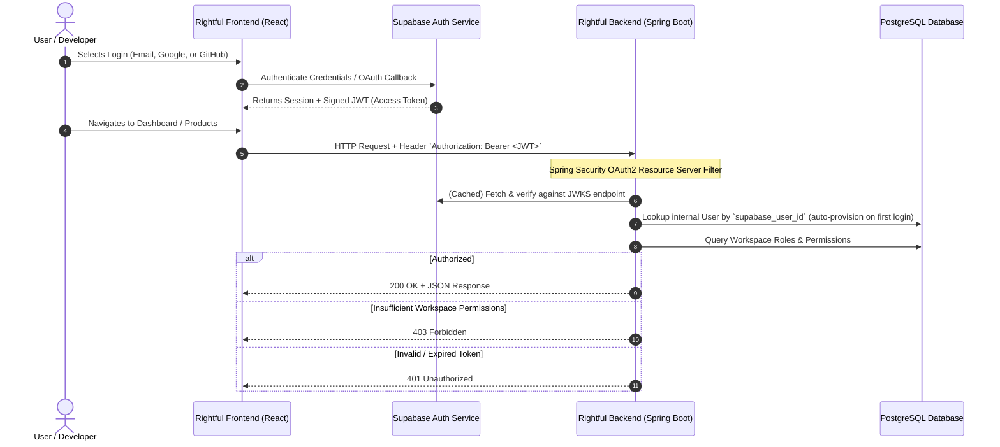

# Rightful – Authentication & Security Architecture

## 1. Authentication Strategy

Rightful deliberately decouples **Authentication (Identity)** from **Authorization (Business Entitlements & Permissions)**:
- **Authentication Provider**: **Supabase Auth** (Hosted Gotrue service).
- **Application Authorization**: **Spring Boot (Resource Server)** with internal Workspace Membership and Role-Based Access Control (RBAC).



---

## 2. Authentication Methods Supported

1. **Email & Password**: Handled directly by Supabase Auth with standard password hashing (Argon2 / bcrypt) and email verification workflows.
2. **Google OAuth**: One-click social sign-in using Google Cloud OAuth credentials configured in Supabase.
3. **GitHub OAuth**: Developer-focused social login using GitHub OAuth App credentials.

---

## 3. Token Verification in Spring Boot

Spring Boot functions strictly as an **OAuth2 Resource Server** using Spring Security's native JWT support:
- Spring Boot **does not issue** access tokens or refresh tokens.
- Tokens are validated statelessly using the Supabase JWKS (JSON Web Key Set) URL:
  ```
  ${SUPABASE_URL}/auth/v1/.well-known/jwks.json
  ```
- Public keys are fetched over HTTPS, validated, and cached in memory to maintain sub-millisecond request verification.
- Validated claims extracted by Spring Boot:
  - `sub`: Unique UUID representing the Supabase user identity.
  - `email`: Authenticated email address.
  - `exp`: Token expiration timestamp.

---

## 4. User Provisioning & Identity Synchronization

When a valid JWT reaches the Spring Boot backend:
1. An authentication filter extracts the `sub` claim.
2. The `IdentityService` checks if an internal `User` record exists for `supabase_user_id`.
3. **Just-In-Time (JIT) Provisioning**: If no internal record exists (first visit), Rightful automatically creates the user profile and generates a default personal workspace.
4. The authenticated principal is populated into Spring Security's `SecurityContextHolder`.

---

## 5. Security Invariants & Boundaries

- **Zero Secret Exposure**: The Supabase service role secret is never sent to the client. The frontend uses only the `SUPABASE_ANON_KEY`.
- **Stateless Authorization**: All API endpoints require bearer tokens; session state and cookies are avoided on backend endpoints.
- **CORS Hardening**: Strict Cross-Origin Resource Sharing (CORS) configuration permits only whitelisted frontend origins.
- **Rate Limiting (Planned)**: Public validation endpoints will enforce IP- and key-based bucket rate limiting to prevent brute-force key guessing.

