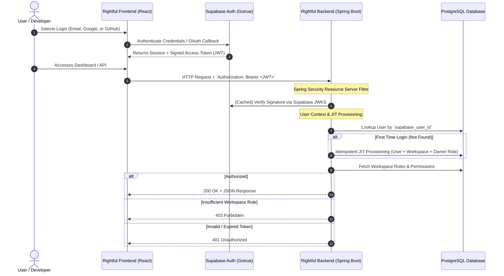

# Rightful – Authentication & Security Architecture (Step 3.3)

## 1. Authentication Strategy & Provider Ownership

Rightful strictly separates **Identity/Authentication** from **Application Authorization**:
- **Identity Provider (IdP)**: **Supabase Auth** (Hosted Gotrue engine).
- **Application Authorization**: **Spring Boot (OAuth2 Resource Server)** with multi-tenant Workspace Membership and Role-Based Access Control (RBAC).



---

## 2. Authentication Methods & Supabase Features Supported

1. **Email & Password**: Handled entirely by Supabase Gotrue. Passwords are never seen, hashed, or stored by Rightful.
2. **Google OAuth 2.0**: Turnkey social sign-in via Google Cloud credentials configured in Supabase.
3. **GitHub OAuth 2.0**: Developer-focused social authentication.
4. **Email Verification**: Enforced at the Supabase Auth tier before tokens carry `email_confirmed_at`.
5. **Password Recovery**: Secure, out-of-band magic link password resets managed by Supabase.
6. **Session & Refresh Management**: Frontend refreshes short-lived access tokens (typically 1 hour) via Supabase Auth client SDK.

---

## 3. Idempotent First-Login Provisioning Workflow

When an authenticated user invokes the Rightful API for the first time, their profile and primary workspace must be provisioned seamlessly.

### 3.1 Concurrency & Race Condition Challenge
In modern single-page applications, initial page load often triggers multiple concurrent API requests (e.g. `GET /workspaces`, `GET /user/profile`, `GET /notifications`). Multiple requests with the same new JWT can hit Spring Boot simultaneously.

### 3.2 Idempotent JIT Provisioning Algorithm
```mermaid
flowchart TD
    Req["Incoming API Request with Bearer JWT"] --> Extract["Extract `sub` (supabase_user_id) and `email`"]
    Extract --> Check["SELECT id FROM users WHERE supabase_user_id = :sub"]
    
    Check -->|Exists| ReturnUser["Set SecurityContext with existing User and proceed"]
    
    Check -->|Not Found| BeginTx["Begin Transaction (READ COMMITTED)"]
    BeginTx --> UpsertUser["INSERT INTO users (id, supabase_user_id, email, full_name)<br/>VALUES (gen_random_uuid(), :sub, :email, :name)<br/>ON CONFLICT (supabase_user_id) DO NOTHING"]
    
    UpsertUser --> CheckInserted{"Row Inserted?"}
    
    CheckInserted -->|Yes| CreateWS["1. INSERT INTO workspaces (name = 'Personal Workspace', owner_id = user.id)<br/>2. INSERT INTO workspace_members (workspace_id, user_id, role = 'OWNER')<br/>3. INSERT INTO user_preferences (user_id, default_workspace_id)"]
    CreateWS --> CommitTx["Commit Transaction"]
    
    CheckInserted -->|No (Concurrent Winner)| FetchWinner["SELECT id FROM users WHERE supabase_user_id = :sub"]
    FetchWinner --> CommitTx
    CommitTx --> ReturnUser
```

### 3.3 Database Constraints Guaranteeing Idempotency
- `users(supabase_user_id)` has a `UNIQUE` constraint.
- `workspace_members(workspace_id, user_id)` has a `UNIQUE` composite constraint.
- `user_preferences(user_id)` has a `UNIQUE` constraint.

---

## 4. Account Linking & Identity Provider Differences

- **Supabase Auth Ownership**: When a user logs in with Google and subsequently links GitHub (or logs in with matching verified emails), Supabase Auth associates both identities under the same persistent `auth.users(id)`.
- **Rightful Immutability**: Rightful keys application records strictly to `supabase_user_id`. When identities are linked in Supabase, the application user ID remains unchanged.
- **Email Synchronization**: If a user updates their email in Supabase Auth, a background reconciliation hook or token inspection updates `users.email` without modifying surrogate keys.

---

## 5. PostgreSQL Row Level Security (RLS) & Spring Boot Integration

Rightful employs a **defense-in-depth** strategy combining application-level security with database-level Row Level Security.

### 5.1 The Privileged Connection Pool Problem
- Spring Boot uses HikariCP with connection pooling, connecting to PostgreSQL as a privileged database user (e.g., `postgres` or `rightful_app`).
- By default in PostgreSQL, superusers and roles with the `BYPASSRLS` attribute bypass all RLS policies.

### 5.2 Architectural Solution: Session-Scoped Context Setting
1. **Dedicated Database Application Role**: The Spring Boot connection pool authenticates using a dedicated role `rightful_app_role` created with `NOBYPASSRLS`:
   ```sql
   CREATE ROLE rightful_app_role WITH LOGIN PASSWORD '...' NOBYPASSRLS;
   ```
2. **Context Setting via Connection Interceptor**:
   When Spring Boot executes a tenant request, the service layer sets session variables before running queries:
   ```sql
   SET LOCAL app.current_workspace_id = '9f8e7d6c-5b4a-3210-fedc-ba9876543210';
   SET LOCAL app.current_user_id = '11223344-5566-7788-99aa-bbccddeeff00';
   ```
3. **Database RLS Policy Definition**:
   ```sql
   ALTER TABLE licenses ENABLE ROW LEVEL SECURITY;
   
   CREATE POLICY workspace_isolation_policy ON licenses
       FOR ALL
       TO rightful_app_role
       USING (workspace_id = NULLIF(current_setting('app.current_workspace_id', true), '')::UUID)
       WITH CHECK (workspace_id = NULLIF(current_setting('app.current_workspace_id', true), '')::UUID);
   ```

---

## 6. Security Threat Modeling (STRIDE Analysis)

| Threat Category | Potential Attack Vector | Rightful Mitigation Design |
| :--- | :--- | :--- |
| **Spoofing** | Forged JWT access token to masquerade as another user. | Asymmetric signature verification using official Supabase JWKS with short cache TTL and strict `iss`/`aud` validation. |
| **Tampering** | Modifying offline entitlement tokens or tampering with database license records. | Ed25519 digital signatures on entitlement tokens; HMAC-SHA-256 non-reversible digests stored in database. |
| **Repudiation** | An admin revoking a license and denying the action. | Immutable `audit_logs` table recording `actor_id`, `actor_type`, IP address, timestamp, and JSON diffs. |
| **Information Disclosure**| Database breach leaking active software license keys. | Plaintext keys are never stored; only `key_hash` (HMAC-SHA-256) is persisted. Product Ed25519 private keys encrypted with AES-256-GCM. |
| **Denial of Service** | Flooding `/api/v1/validation/heartbeat` with invalid requests to exhaust database connections. | Fast-fail HMAC lookup, Redis bucket rate limiting per IP and product, and connection pool sizing. |
| **Elevation of Privilege**| User from Workspace A attempting to read/modify licenses in Workspace B (IDOR). | Dual-layer enforcement: Spring Security `@PreAuthorize("@workspaceSecurity.hasAccess(...)")` + mandatory `workspace_id` JPA predicates + PostgreSQL RLS. |

---

## 7. Step 3.7 Implementation Reference: Supabase Auth & JWT Verification

### 7.1 Verified Supabase JWKS & Algorithm Configuration
- **Supabase Project Reference**: `kcyccddrzsfxgrkeenop`
- **JWKS Endpoint**: `https://kcyccddrzsfxgrkeenop.supabase.co/auth/v1/.well-known/jwks.json`
- **Signing Algorithm**: Asymmetric `ES256` (Elliptic Curve NIST P-256 / secp256r1) with key rotation support. Fallback `RS256` also enabled in `NimbusJwtDecoder`.
- **Issuer (`iss`)**: `https://kcyccddrzsfxgrkeenop.supabase.co/auth/v1`
- **Audience (`aud`)**: `authenticated`
- **Subject (`sub`)**: Verified Supabase User UUID.

### 7.2 Backend Spring Security Configuration
Implemented in [`SecurityConfig.java`](file:///d:/RIGHTFUL.com/backend/src/main/java/com/rightfull/security/SecurityConfig.java):
1. **OAuth2 Resource Server**: Uses `NimbusJwtDecoder.withJwkSetUri(...)` with dynamic JWKS caching and key rotation.
2. **Token Validators**:
   - `JwtTimestampValidator`: Validates `exp`, `iat`, `nbf` with a 60-second clock skew tolerance.
   - `JwtIssuerValidator`: Strict issuer matching.
   - `AudienceValidator`: Enforces `aud == 'authenticated'`.
   - `SubjectValidator`: Enforces `sub` is non-empty and parses into a valid RFC 4122 UUID.
3. **RestAuthenticationEntryPoint**: Intercepts missing, invalid, or expired tokens and returns HTTP 401 with standardized JSON `ApiResponse.error("UNAUTHORIZED", ...)`.
4. **RestAccessDeniedHandler**: Returns HTTP 403 with `ApiResponse.error("FORBIDDEN", ...)`.

### 7.3 Transactional First-Login Provisioning
Implemented in [`UserProvisioningService.java`](file:///d:/RIGHTFUL.com/backend/src/main/java/com/rightfull/identity/service/UserProvisioningService.java):
1. User presents a valid Supabase JWT on any authenticated endpoint (e.g. `GET /api/v1/users/me`).
2. Checks `users` table by `supabase_user_id`.
3. If not found:
   - Inserts `User` record from JWT verified claims (`sub`, `email`, `fullName`, `avatarUrl`).
   - Generates personal workspace with sanitized slug adhering to `^[a-z0-9-]+$`.
   - Inserts `WorkspaceMember` with `role = OWNER`.
   - Inserts `UserPreferences` with `default_workspace_id = workspace.id`.
   - Commits atomically within `@Transactional`.
4. **Concurrency Safety**: Handled via `users(supabase_user_id)` unique constraint and graceful fallback in `DataIntegrityViolationException`.

### 7.4 Multi-Tenant Database Isolation & Role Separation (Step 3.9 Implementation)
- **Role Separation**:
  - **Migration Administrator (`postgres`)**: Executes Flyway DDL migrations (`FLYWAY_USER`, `FLYWAY_PASSWORD`).
  - **Application Runtime (`rightfull_app`)**: Restricted role with `NOBYPASSRLS`, `NOSUPERUSER`, `NOCREATEDB`. Granted strictly DML (`SELECT, INSERT, UPDATE, DELETE`) on `public` tables.
- **Transaction-Scoped Tenant Context**:
  - Managed by `TenantContextManager` and `TenantContextAspect`.
  - Sets transaction-local PostgreSQL settings via `set_config('app.current_workspace_id', :wsId, true)` (`is_local = true`).
  - PostgreSQL automatically unbinds and clears context upon transaction commit/rollback, guaranteeing zero pool contamination across pooled HikariCP connections.
- **Row-Level Security (RLS)**:
  - All tenant tables (`workspaces`, `workspace_members`, `workspace_invitations`, `audit_logs`) enforce RLS policies evaluated using `app_current_workspace_id()`.
  - Attempts to read, write, update, or delete rows outside the active workspace are denied at the database engine level.
- **Immutable Persistent Auditing**:
  - Implemented in `PersistentWorkspaceAuditService` and `audit_logs` table.
  - Immutability enforced by database trigger `trg_audit_logs_prevent_mutation`.
  - Structured logs retained for SIEM monitoring. Sensitive credentials (passwords, tokens, private keys) are scrubbed before persistence.

