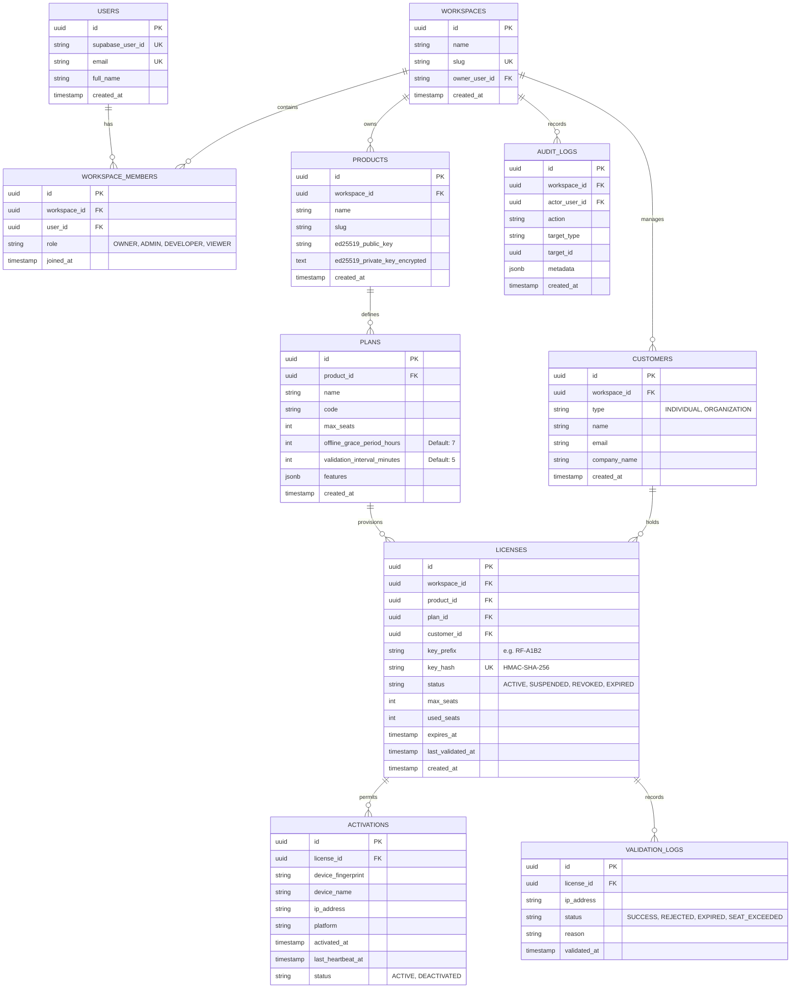

# Rightful – Database Architecture & Entity Design

## 1. Overview & Strategy

Rightful leverages **Supabase PostgreSQL** as its primary persistent relational datastore. The persistence model is designed to support:
- Strict multi-tenant isolation via workspace partitioning.
- High-throughput license validation and device heartbeats.
- Zero plaintext storage of sensitive license keys (HMAC-SHA-256 hashed).
- Idempotent and version-controlled schema evolution using **Flyway**.

> [!NOTE]
> Detailed entity mappings, foreign keys, and indexes will be finalized in **Milestone Step 3.3**. The schema layout below represents the architectural design blueprint.

---

## 2. High-Level Entity Relationship Diagram (Proposed)

---

## 3. Cryptographic Storage Guarantees

1. **License Key Storage**:
   - Plaintext license keys (e.g., `RF-PROD-98FA-C12B-789E-AA01`) are returned **only once** upon creation.
   - The database stores only a non-reversible `key_hash = HMAC-SHA256(key, application_hmac_secret)` and a short display prefix (e.g. `RF-PROD-98FA-****`).
   - If a database backup is compromised, attackers cannot reconstruct valid license keys.
2. **Product Entitlement Signing Keys**:
   - Each product possesses a unique Ed25519 keypair.
   - The public key is publicly accessible and embedded into client applications.
   - The private key is encrypted at rest using envelope encryption (AES-256-GCM with master key) before saving into `ed25519_private_key_encrypted`.

---

## 4. Multi-Tenant Partitioning & Data Isolation

- **Workspace Scoping**: All operational tables (`products`, `plans`, `customers`, `licenses`, `audit_logs`) carry a mandatory, foreign-keyed `workspace_id` column.
- **Query Protection**: Application layer services enforce workspace-scoped criteria on all database reads and writes. Cross-workspace data querying is strictly prevented.
- **Row Level Security (RLS) Readiness**: Supabase RLS policies will be introduced in tandem with direct Supabase client calls if required, while Spring Boot enforces security via JPA Specification predicates and tenant filter interceptors.

---

## 5. Migration Strategy with Flyway

- All DDL statements are maintained under `backend/src/main/resources/db/migration/`.
- File naming convention follows standard Flyway semantics: `V<Version>__<Description>.sql`.
- In accordance with milestone boundaries, no business tables are executed initially; `V1__init_schema.sql` establishes the schema baseline.
