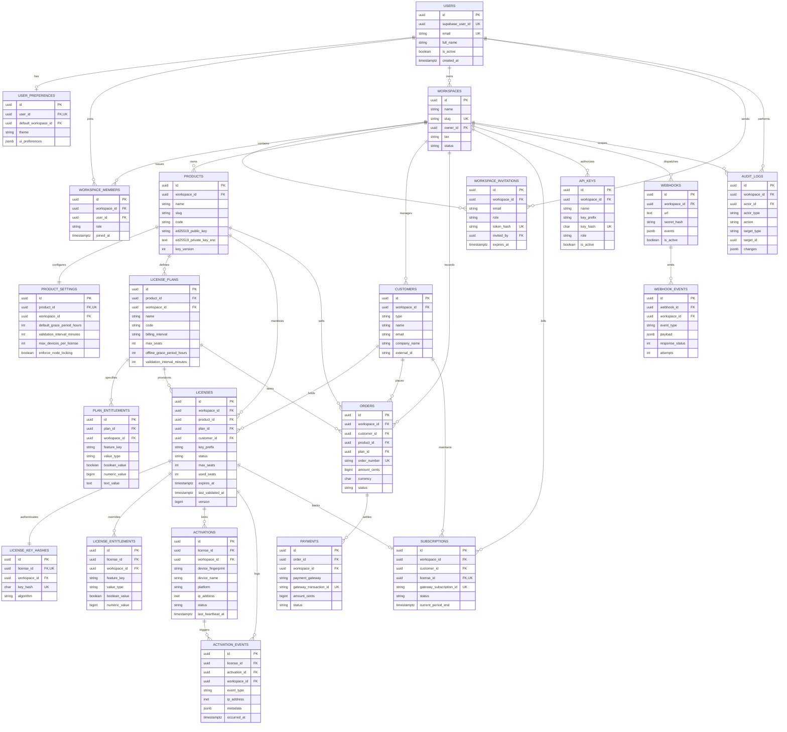

# Rightful – Entity Relationships & JPA Mapping Specification (Step 3.3)

## 1. Complete Domain Entity-Relationship Diagram

The following Mermaid diagram maps all 22 domain tables, their relationships, foreign keys, and exact cardinalities.



---

## 2. Entity Relationship Inventory

| Parent Entity | Child Entity | Foreign Key Column | Cardinality | Relational Semantics & Constraints | On Delete Action |
| :--- | :--- | :--- | :---: | :--- | :--- |
| `users` | `user_preferences` | `user_id` | 1 : 0..1 | One-to-one user UI preferences. | `CASCADE` |
| `users` | `workspaces` | `owner_id` | 1 : N | User creates and owns default/personal workspace. | `RESTRICT` |
| `users` | `workspace_members`| `user_id` | 1 : N | User belongs to one or more workspaces. | `CASCADE` |
| `workspaces` | `workspace_members`| `workspace_id` | 1 : N | Workspace contains multiple team members. | `CASCADE` |
| `workspaces` | `workspace_invitations` | `workspace_id` | 1 : N | Workspace contains pending team invitations. | `CASCADE` |
| `workspaces` | `products` | `workspace_id` | 1 : N | Workspace owns registered software products. | `CASCADE` |
| `products` | `product_settings` | `product_id` | 1 : 1 | Product has exactly one operational configuration. | `CASCADE` |
| `products` | `license_plans` | `product_id` | 1 : N | Product defines one or more license plan tiers. | `CASCADE` |
| `license_plans` | `plan_entitlements` | `plan_id` | 1 : N | Plan grants specific feature flags/quotas. | `CASCADE` |
| `workspaces` | `customers` | `workspace_id` | 1 : N | Workspace manages individual/org customers. | `CASCADE` |
| `products` | `licenses` | `product_id` | 1 : N | License is issued for a specific product. | `RESTRICT` |
| `license_plans` | `licenses` | `plan_id` | 1 : N | License is provisioned under a specific plan. | `RESTRICT` |
| `customers` | `licenses` | `customer_id` | 1 : N | Customer is the legal holder of the license. | `RESTRICT` |
| `licenses` | `license_key_hashes` | `license_id` | 1 : 1 | Non-reversible HMAC digest for validation lookup. | `CASCADE` |
| `licenses` | `license_entitlements`| `license_id` | 1 : N | Per-license customized feature overrides. | `CASCADE` |
| `licenses` | `activations` | `license_id` | 1 : N | Node-locked hardware activations bound to license. | `CASCADE` |
| `licenses` | `activation_events` | `license_id` | 1 : N | Validation heartbeat and activation telemetry. | `CASCADE` |
| `activations` | `activation_events` | `activation_id` | 1 : N | Telemetry events linked to specific device. | `SET NULL` |
| `customers` | `orders` | `customer_id` | 1 : N | Commercial orders placed by customer. | `RESTRICT` |
| `orders` | `payments` | `order_id` | 1 : N | Payment transaction executions for an order. | `CASCADE` |
| `customers` | `subscriptions` | `customer_id` | 1 : N | Recurring billing subscriptions. | `RESTRICT` |
| `licenses` | `subscriptions` | `license_id` | 1 : 0..1 | License provisioned and renewed by subscription. | `SET NULL` |
| `workspaces` | `api_keys` | `workspace_id` | 1 : N | Developer M2M API keys. | `CASCADE` |
| `workspaces` | `webhooks` | `workspace_id` | 1 : N | Outgoing HTTP webhook destinations. | `CASCADE` |
| `webhooks` | `webhook_events` | `webhook_id` | 1 : N | Delivery attempt logs for webhook. | `CASCADE` |
| `workspaces` | `audit_logs` | `workspace_id` | 1 : N | Immutable compliance audit trail. | `CASCADE` |

---

## 3. Spring Data JPA Entity Mapping Guidelines

Rightful adheres to high-performance, strictly isolated JPA conventions across all domain modules:

### 3.1 Strict Fetch Strategy Rules
- **Rule**: All `@ManyToOne` and `@OneToOne` associations **must** explicitly declare `fetch = FetchType.LAZY`.
  ```java
  // CORRECT: Prevents silent eager loading and N+1 query storms
  @ManyToOne(fetch = FetchType.LAZY, optional = false)
  @JoinColumn(name = "workspace_id", nullable = false)
  private Workspace workspace;
  ```
- **Collection Associations**: All `@OneToMany` collections default to `FetchType.LAZY` and should be mapped using `Set<T>` or `List<T>`. When child records are needed, use Spring Data JPA `@EntityGraph` or targeted JPQL `JOIN FETCH` queries.

### 3.2 Cascade Rules & Relational Boundaries
- **Intra-Aggregate Cascade**: Cascade operations (`CascadeType.ALL`, `orphanRemoval = true`) are permitted **only** between an Aggregate Root and its strictly owned private entities:
  - `Product` -> `ProductSettings`
  - `LicensePlan` -> `PlanEntitlement`
  - `License` -> `LicenseKeyHash`
  - `License` -> `LicenseEntitlement`
- **Inter-Aggregate Boundaries**: Foreign keys between distinct domain roots (`License` -> `Product`, `License` -> `Customer`, `Order` -> `Customer`) **must never** cascade deletes. Foreign key constraints enforce `ON DELETE RESTRICT` at the PostgreSQL level to preserve financial and licensing historical integrity.

### 3.3 Enum Type Mapping
- All domain enumerations (`Role`, `LicenseStatus`, `CustomerType`, `BillingInterval`, `EventType`) must be stored as strings using:
  ```java
  @Enumerated(EnumType.STRING)
  @Column(name = "status", length = 32, nullable = false)
  private LicenseStatus status;
  ```

### 3.4 Entity Auditing & Optimistic Locking
- Base entities inherit from an abstract `@MappedSuperclass` providing:
  ```java
  @CreatedDate
  @Column(name = "created_at", nullable = false, updatable = false)
  private Instant createdAt;

  @LastModifiedDate
  @Column(name = "updated_at", nullable = false)
  private Instant updatedAt;
  ```
- Mutable, concurrency-sensitive entities (`License`, `DeviceActivation`, `Workspace`) incorporate a `@Version` field for optimistic concurrency checks:
  ```java
  @Version
  @Column(name = "version", nullable = false)
  private Long version;
  ```

### 3.5 DTO Separation Boundary
- **Architectural Invariant**: JPA `@Entity` classes must never be returned from REST controllers or accepted as request parameters.
- Feature modules declare typed, validated Request/Response DTOs (`LicenseResponse`, `CreateLicenseRequest`) with explicit mapping mappers to ensure zero internal entity leakage.

---

## 4. Implementation Phasing & Migration Status

### 4.1 Phase 1 (Step 3.6 - Active in PostgreSQL): Core Identity & Workspaces
The following 4 foundational entities are fully migrated and live in the database via `V1__init_core_schema.sql`:
1. `users` (Identity Root)
2. `user_preferences` (User Settings)
3. `workspaces` (Tenant Root)
4. `workspace_members` (RBAC Join)

### 4.2 Phase 2 (Step 3.8 - Active in Migration Schema): Workspace Invitations
Added in `V2__workspace_invitations.sql`:
5. `workspace_invitations` (Team Collaboration & Single-Use Hashed Tokens)

### 4.3 Phase 3+ (Deferred Domain Entities):
The remaining 17 tables defined in this document are strictly deferred to subsequent feature implementation steps:
- Software Catalog & Configuration: `products`, `product_settings`, `license_plans`, `plan_entitlements`
- Licensing & Device Activations: `customers`, `licenses`, `license_entitlements`, `license_key_hashes`, `activations`, `activation_events`
- Commerce & Subscriptions: `orders`, `payments`, `subscriptions`
- Integrations & Auditing: `api_keys`, `webhooks`, `webhook_events`, `audit_logs`


