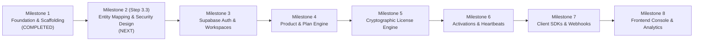

# Rightful – Implementation Roadmap & Milestone Plan

## 1. Roadmap Architecture

The engineering plan for Rightful is organized into progressive, verifiable milestones designed to deliver a hardened, production-grade licensing platform.

---

## 2. Milestone Breakdown

### Milestone 1: Initial Foundation & Monorepo Scaffold (Current Milestone)
- [x] Monorepo repository layout (`frontend/`, `backend/`, `docs/`, `infrastructure/`).
- [x] Frontend foundation: React 19, Vite, TypeScript strict mode, Tailwind CSS v4, Lucide React, React Router, TanStack Query, React Hook Form, Zod, Motion.
- [x] Backend foundation: Java 25 LTS, Spring Boot 3.4.x, Maven, Spring Security, Spring Data JPA, Flyway, Actuator, OpenAPI.
- [x] Architecture specifications and cryptographic design documentation.
- [x] Environment configuration templates (`.env.example`).
- [x] Base health endpoints and automated test verification.

---

### Milestone 2: Step 3.3 – Final Database Entity Mapping and Security Design (CONFIRMED NEXT)
- [ ] Flyway SQL DDL migrations for base domain schemas (`users`, `workspaces`, `workspace_members`, `products`, `plans`, `customers`, `licenses`, `activations`, `audit_logs`).
- [ ] JPA Entity implementations with audit listeners (`@CreatedDate`, `@LastModifiedDate`).
- [ ] Spring Security Resource Server configuration with Supabase JWKS decoder bean.
- [ ] Multi-tenant workspace security evaluator (`@workspaceSecurity`).
- [ ] Cryptographic utility test suite (Ed25519 key generation/verification and HMAC-SHA-256 hashing).

---

### Milestone 3: Authentication & Workspace Multi-Tenancy
- [ ] Supabase Auth client integration in frontend (Email/Password, Google OAuth, GitHub OAuth).
- [ ] Backend JIT user provisioning from Supabase JWT claims.
- [ ] Workspace creation, member invitations, and role management (OWNER, ADMIN, DEVELOPER, VIEWER).
- [ ] Workspace switching in React UI with session synchronization.

---

### Milestone 4: Product Catalog & Plan Configuration
- [ ] Product registration with automatic Ed25519 keypair generation and secure storage.
- [ ] Configurable plan tiers (seats, offline grace period: default 7 hours, heartbeat interval: 5 minutes, custom features JSONB).
- [ ] Customer management (individual developers vs corporate organizations).

---

### Milestone 5: Cryptographic License Engine
- [ ] Cryptographically secure random license key generator with prefix and checksum.
- [ ] HMAC-SHA-256 license hashing and lookup pipeline.
- [ ] Ed25519 entitlement token minting service.
- [ ] License lifecycle operations: revocation, suspension, renewal, expiration recalculation.

---

### Milestone 6: Device Activation & Online/Offline Heartbeats
- [ ] Node-locking and hardware fingerprint binding.
- [ ] Concurrent seat enforcement and automatic seat reclamation.
- [ ] 5-minute recurring heartbeat endpoint (`/api/v1/validation/heartbeat`).
- [ ] 7-hour offline grace period enforcement.
- [ ] Validation audit logging and telemetry ingestion.

---

### Milestone 7: Client SDKs & Integration Webhooks
- [ ] Official lightweight TypeScript / Node.js and Java / C# verification SDKs.
- [ ] Outgoing developer webhooks for license lifecycle events (`license.created`, `license.revoked`, `seat.exceeded`).
- [ ] Developer API key management for machine-to-machine integrations.

---

### Milestone 8: Full Management Console & Analytics
- [ ] Rich administrative dashboard: active licenses, churn rate, seat utilization.
- [ ] Interactive license generation wizard.
- [ ] Live telemetry inspector and device activation management.
- [ ] Billing & subscription integration (Stripe / LemonSqueezy) [Proposed].

