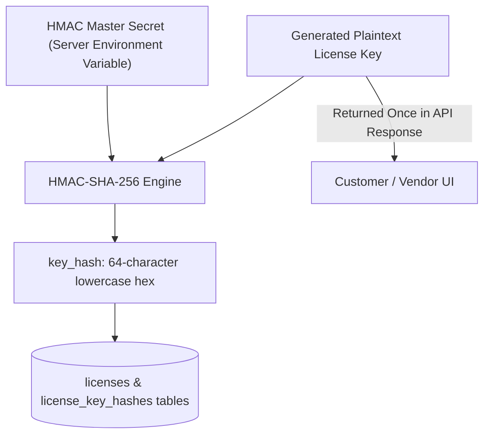
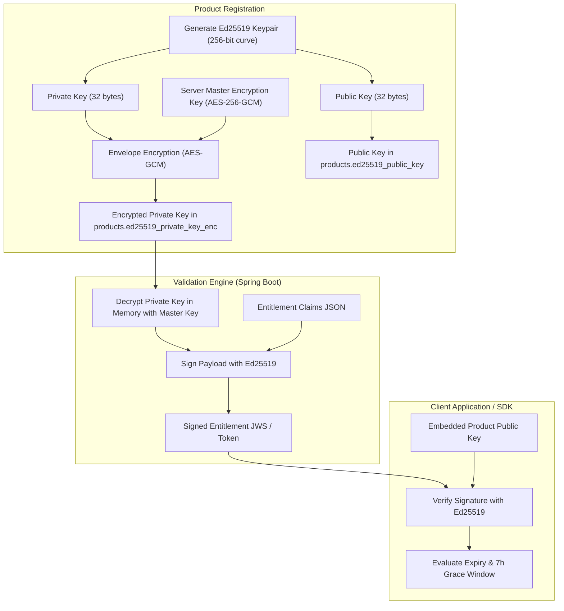

# Rightful – Cryptographic Architecture & License Key Security (Step 3.3)

## 1. Cryptographic Principles & Objectives

Rightful implements industry-standard asymmetric and symmetric cryptography to ensure:
1. **Zero Secret Exposure**: Compromise of application databases or backups must never leak valid plaintext license keys or private signing keys.
2. **Decentralized Offline Verification**: Licensed client applications verify entitlements without calling the central server, using public-key cryptography.
3. **Unforgeable Entitlements**: Client applications can cryptographically verify that an entitlement was signed by the software vendor and has not been altered.

---

## 2. License Key Architecture & HMAC-SHA-256 Hashing

### 2.1 Plaintext License Key Anatomy
License keys are generated using a cryptographically secure pseudo-random number generator (`java.security.SecureRandom`) formatted into an ergonomic, human-readable string:
```
RF-<ENVIRONMENT>-<PRODUCT_CODE>-<RANDOM_ENTROPY>-<CHECKSUM>
Example: RF-PROD-HPC-98FA-C12B-789E-AA01
```
- **Prefix (`RF-PROD-HPC-`)**: Identifies Rightful (`RF`), deployment environment (`PROD`), and product code (`HPC`). The prefix is stored in plaintext in `licenses.key_prefix` to facilitate dashboard search and customer support lookups.
- **Entropy (128+ bits)**: 16 bytes of CSPRNG randomness, Crockford Base32 or hexadecimal encoded.
- **Checksum**: Luhn mod-32 or CRC-16 checksum character appended to catch user typographical errors before sending validation requests.

### 2.2 One-Time Display Guarantee
- When a license key is created (via Dashboard or API), the full plaintext key is returned **in the response payload exactly once**.
- The plaintext key is discarded from memory immediately after response serialization.
- It is never logged, never cached in Redis, and never written to PostgreSQL.

### 2.3 Non-Reversible HMAC-SHA-256 Storage Pipeline


### 2.4 Constant-Time Verification
When a client application submits a license key for validation or activation:
1. Rightful computes `hash = HMAC-SHA256(presented_key, server_secret)`.
2. Queries `license_key_hashes` for `key_hash = hash`.
3. Compares digests in memory using constant-time comparison (`MessageDigest.isEqual()`) to prevent timing side-channel attacks.

### 2.5 HMAC Secret Rotation Strategy
- Primary secret stored in `LICENSE_HMAC_SECRET`.
- Optional secondary secret `LICENSE_HMAC_SECRET_FALLBACK` supports rolling secret transitions without invalidating existing issued keys.

---

## 3. Ed25519 Asymmetric Entitlement Signing Architecture

Rightful uses the **Ed25519** Edwards-curve Digital Signature Algorithm (RFC 8032) for asymmetric signing of software entitlement tokens.

### 3.1 Why Ed25519?
- **Speed**: Signature verification is over 10x faster than RSA-2048.
- **Key & Signature Compactness**: Public keys are 32 bytes; signatures are 64 bytes.
- **Resistance**: High side-channel immunity; deterministic signing eliminates random number generator vulnerabilities during signature generation.

### 3.2 Key Management Lifecycle & Separation


### 3.3 Private Key Envelope Encryption at Rest
- Product private signing keys are **never stored in plaintext** in the database.
- Rightful encrypts each product's Ed25519 private key using `AES-256-GCM` with an authenticated 96-bit initialization vector (IV) and a 128-bit authentication tag, keyed by `ED25519_MASTER_ENCRYPTION_KEY`.
- Private keys **never leave the Spring Boot backend** and are never exposed via REST API, React frontend, or customer SDKs.

### 3.4 Public Key Distribution
- Software vendors embed their product's Ed25519 public key into their desktop, mobile, or CLI application binary at compile time.
- Alternatively, applications query `/api/v1/products/{productId}/public-key` over HTTPS.

### 3.5 Key Rotation & Versioning
- Each product maintains a `key_version INTEGER NOT NULL DEFAULT 1`.
- When an administrator rotates product keys:
  1. A new Ed25519 keypair is generated with `key_version = N + 1`.
  2. The new public key is registered and published.
  3. Client SDKs accept signed entitlements matching either key version $N$ or $N+1$ during the configured transition window.

---

## 4. Signed Entitlement Token Schema

The signed entitlement token is a compact, URL-safe JSON Web Signature (JWS) payload containing:

```json
{
  "header": {
    "alg": "EdDSA",
    "crv": "Ed25519",
    "kid": "prod_hpc_v1"
  },
  "payload": {
    "iss": "https://api.rightful.com",
    "sub": "lic_9f8e7d6c-5b4a-3210-fedc-ba9876543210",
    "aud": "prod_11223344-5566-7788-99aa-bbccddeeff00",
    "iat": 1730322000,
    "exp": 1730325600,
    "last_validated_at": 1730322000,
    "grace_period_seconds": 25200,
    "device_fingerprint": "fp_8a7d6e5c4b3a21",
    "seats": 5,
    "features": {
      "pro_export": true,
      "max_projects": 100,
      "tier": "enterprise"
    }
  },
  "signature": "64_byte_eddsa_signature_base64url"
}
```

### 4.1 Revocation Handling
- **Online**: When a license is revoked, subsequent 5-minute heartbeat requests return HTTP `403 Forbidden` (`LICENSE_REVOKED`).
- **Offline**: If an application is disconnected when revocation occurs, it continues functioning only until the 7-hour grace period expires. Upon reconnecting, the revoked status is enforced immediately.
