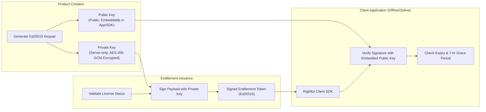
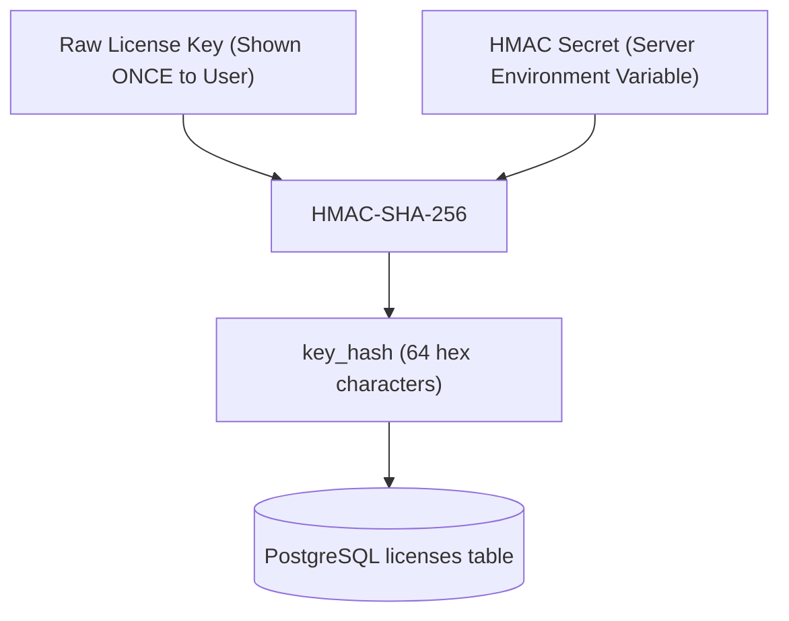

# Rightful – Cryptographic Architecture & License Key Design

## 1. Cryptographic Principles & Objectives

Rightful implements industry-standard modern cryptography to guarantee:
1. **Confidentiality & Non-Recoverability**: Compromised server databases must not yield functional license keys.
2. **Authenticity & Integrity**: Entitlements must be cryptographically unforgeable by third parties.
3. **Decentralized Verification**: Client applications must be able to verify valid entitlements offline without contacting the server, using public-key cryptography.

---

## 2. Asymmetric Cryptography: Ed25519 Entitlements

Rightful uses the **Ed25519** Edwards-curve Digital Signature Algorithm (RFC 8032) for entitlement token signing.

### 2.1 Why Ed25519?
- **High Performance**: Signature generation and verification are orders of magnitude faster than RSA-2048/4096.
- **Small Footprint**: Public keys are 32 bytes; signatures are 64 bytes.
- **Collision Resistance & Security**: Immune to side-channel cache attacks, random number generator pitfalls during signing, and timing attacks.

### 2.2 Key Lifecycle & Separation


---

## 3. License Key Generation & HMAC-SHA-256 Hashing

### 3.1 Plaintext License Key Anatomy
License keys follow a formatted, human-readable structure:
```
RF-<ENVIRONMENT>-<PRODUCT_CODE>-<RANDOM_ENTROPY>-<CHECKSUM>
Example: RF-PROD-WRK1-8F4C-9D2E-7B1A-54E3
```
- Total entropy: 128+ bits cryptographically secure random bytes (CSPRNG).
- Prefix: Allows rapid identification without exposing secret entropy.

### 3.2 Key Hashing Flow


- When a client presents a license key for validation, Rightful computes `HMAC-SHA-256(presented_key, secret)` and queries the database for matching `key_hash`.
- Even with read-access to the database, attackers cannot reverse the hash to obtain raw valid keys.

---

## 4. Signed Entitlement Token Payload (Claims)

```json
{
  "iss": "https://api.rightful.com",
  "sub": "lic_9f8e7d6c-5b4a-3210-fedc-ba9876543210",
  "aud": "prod_11223344-5566-7788-99aa-bbccddeeff00",
  "iat": 1730322000,
  "exp": 1730325600,
  "last_validated_at": 1730322000,
  "grace_period_seconds": 25200,
  "device_id": "fp_8a7d6e5c4b3a21",
  "seats": 5,
  "features": [
    "export_4k",
    "unlimited_projects",
    "cloud_sync"
  ]
}
```
Client SDKs inspect `last_validated_at` and `grace_period_seconds` to allow offline work up to the deadline.
