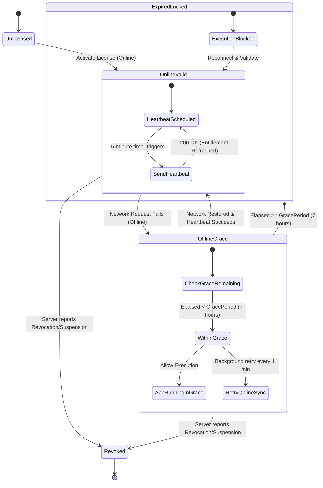

# Rightful – Offline Validation & Heartbeat Lifecycle

## 1. Hybrid Validation Philosophy

Modern software runs in diverse network environments: remote fieldwork, flights, flaky office networks, or secure air-gapped zones. Software licensing must be resilient against transient network failures while preventing indefinite unauthorized usage.

Rightful enforces a **Hybrid Online/Offline Validation Model**:
- **Connected (Online) State**: Validation heartbeats occur every **5 minutes**.
- **Offline / Disconnected State**: Client enters a default **7-hour offline grace period**.
- **Configurability**: The grace period is customizable per product or license plan tier (e.g. 7 hours for standard tiers, 72 hours for enterprise air-gapped field workers).

---

## 2. Heartbeat & Grace Period State Machine

---

## 3. Mathematical Formula for Grace Evaluation

When evaluating license validity locally, the client SDK calculates:

$$\text{CurrentTime} - \text{LastValidatedAt} \le \text{GracePeriodSeconds}$$

- **Default Parameters**:
  - `OnlineValidationInterval`: $300\text{ seconds } (5\text{ minutes})$
  - `DefaultGracePeriod`: $25,200\text{ seconds } (7\text{ hours})$
  - `LastValidatedAt`: Server-signed UTC Unix timestamp embedded in the Ed25519 entitlement token.

---

## 4. Anti-Tampering & Clock Skew Mitigation

To prevent end-users from extending grace periods by rolling back system clocks:
1. **Monotonic Clocks**: Client SDKs measure elapsed time using OS monotonic timers (e.g., `clock_gettime(CLOCK_MONOTONIC)` in POSIX, `System.nanoTime()` in Java, `performance.now()` in Web/Electron, `QueryPerformanceCounter` on Windows).
2. **Encrypted Local Heartbeat State**: The SDK writes a signed local state cache recording the maximum observed timestamp. If `SystemTime < LastRecordedTime`, clock rollback is detected and the application immediately enters restricted mode.
3. **Server-Signed Expiration Bounds**: The entitlement token's `iat` and `exp` are certified by the server's Ed25519 signature; modifying the token invalidates the cryptographic signature.

