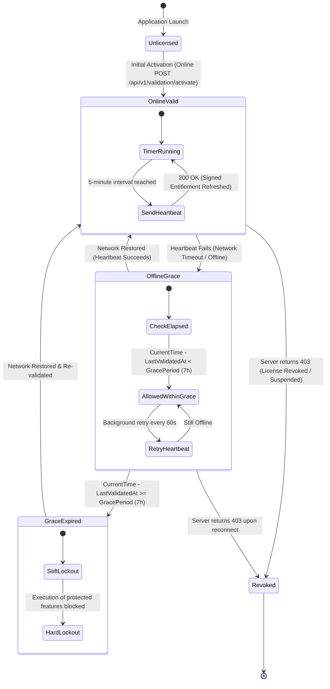

# Rightful – Offline Validation & Heartbeat Lifecycle Specification (Step 3.3)

## 1. Architectural Philosophy

Rightful recognizes that modern client applications (desktop software, developer CLI utilities, field agents, on-premise appliances) operate in varying network conditions. Applications must remain responsive during temporary network disruptions while strictly preventing unauthorized long-term software execution.

To balance developer user experience with vendor revenue protection, Rightful enforces a **Hybrid Online/Offline Validation Model**:
1. **Online Heartbeat**: Validated client applications submit a lightweight heartbeat every **5 minutes**.
2. **Offline Grace Window**: When network communication fails, the application falls back to a **7-hour offline grace period**.
3. **Grace Origin**: Grace duration is measured strictly from the `last_validated_at` timestamp signed by the server.
4. **Enforcement**: Once the grace period expires, access to protected application functionality is blocked immediately until a successful validation heartbeat reconnects with Rightful.

---

## 2. Validation State Machine

---

## 3. Database Schema Supporting Offline Validation

The following columns across the database schema directly support offline grace tracking and validation telemetry:

| Table | Column Name | Type | Purpose in Offline Validation |
| :--- | :--- | :--- | :--- |
| `product_settings`| `default_grace_period_hours` | `INTEGER` | Product-wide fallback grace duration (Default: `7`). |
| `product_settings`| `validation_interval_minutes`| `INTEGER` | Product-wide heartbeat interval (Default: `5`). |
| `license_plans` | `offline_grace_period_hours` | `INTEGER` | Plan-level grace duration override (e.g. `72` for enterprise). |
| `license_plans` | `validation_interval_minutes`| `INTEGER` | Plan-level heartbeat interval override. |
| `licenses` | `last_validated_at` | `TIMESTAMPTZ`| Last timestamp server certified entitlement validity. |
| `licenses` | `offline_grace_period_hours`| `INTEGER` | Per-license specific grace duration override. |
| `activations`      | `last_heartbeat_at` | `TIMESTAMPTZ`| Device-specific timestamp of last received heartbeat. |
| `activation_events`| `occurred_at` | `TIMESTAMPTZ`| Audit log timestamp of heartbeat attempt. |

---

## 4. Client-Side Evaluation Algorithm & Contract

When an application starts or runs a protected feature:

1. **Check Local Entitlement**:
   - The application reads its cached signed entitlement token (JWS).
   - Verifies the cryptographic signature using the embedded product **Ed25519 public key**.
   - If signature verification fails, the token is rejected immediately.
2. **Evaluate Expiration & Grace Duration**:
   $$\Delta t = t_{\text{current}} - t_{\text{last\_validated}}$$
   - If $\Delta t < \text{grace\_period\_seconds}$ (default $25,200\text{ seconds}$ / $7\text{ hours}$):
     - The application continues executing normally in **Offline Grace Mode**.
     - A background task attempts to reconnect to `/api/v1/validation/heartbeat` every 60 seconds.
   - If $\Delta t \ge \text{grace\_period\_seconds}$:
     - The application transitions to **Grace Expired (Locked)**.
     - Protected business logic throws a licensing exception and prompts the user to connect to the internet.

---

## 5. Anti-Clock-Tampering Strategies

End-users may attempt to extend offline grace indefinitely by setting system clocks backwards. Rightful client SDKs employ three complementary defenses:

1. **OS Monotonic Clock Integration**:
   - SDKs measure elapsed time using hardware monotonic timers that cannot be manipulated by user-space date/time adjustments:
     - Linux/Android: `clock_gettime(CLOCK_MONOTONIC_RAW)`
     - macOS/iOS: `mach_continuous_time()`
     - Windows: `QueryPerformanceCounter()`
     - JVM / Java: `System.nanoTime()`
     - Web / Electron: `performance.now()`
2. **Encrypted High-Water Mark Local Cache**:
   - The SDK periodically writes a signed, encrypted state record storing the maximum observed UTC timestamp $t_{\text{max}}$.
   - If $t_{\text{current}} < t_{\text{max}} - 60\text{ seconds}$ (clock skew threshold), the SDK detects backward clock manipulation and immediately suspends grace.
3. **Signed Server Timestamp Bounds**:
   - The entitlement token's `iat`, `exp`, and `last_validated_at` are digitally certified by the server's Ed25519 private key; any manual modification invalidates the token signature.
