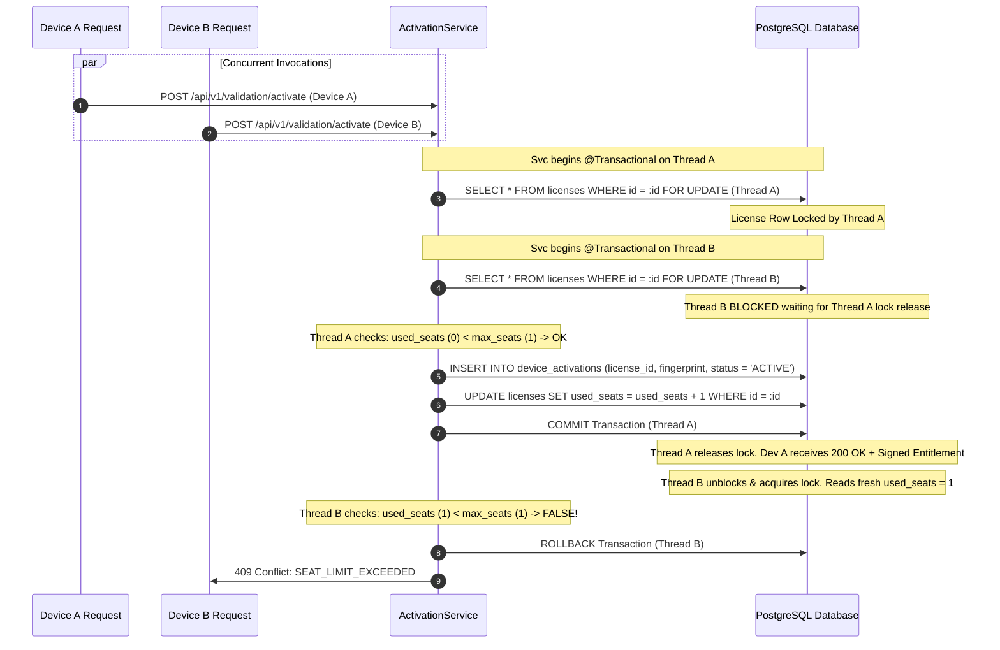

# Rightful – Transaction & Concurrency Strategy Specification (Step 3.3)

## 1. Concurrency Challenges in Licensing Systems

In a high-scale SaaS licensing engine, high-concurrency race conditions can compromise business rules:
- **Device Seat Limit Bypass**: Multiple devices activating simultaneously with the same license key could exceed `max_seats` if seat counts are read and incremented non-atomically.
- **Duplicate User/Workspace Provisioning**: Concurrent first-login requests from multiple browser tabs could produce duplicate workspaces or duplicate user records.
- **Race in License Issuance & Hash Collision**: Multiple issuance jobs operating concurrently.
- **Stale Updates during License Renewal/Revocation**: Conflicting administrative actions overriding revocation state.

Rightful addresses these challenges using explicit database constraints, row-level pessimistic locking, optimistic versioning, and carefully configured Spring `@Transactional` boundaries.

---

## 2. Domain Transaction Strategies Matrix

| Operation | Isolation Level | Locking Mechanism | Primary Concurrency Defense |
| :--- | :--- | :--- | :--- |
| **1. User Provisioning** | `READ_COMMITTED` | DB Unique Index | `ON CONFLICT (supabase_user_id) DO NOTHING` |
| **2. Workspace Creation** | `READ_COMMITTED` | DB Unique Index | Atomic multi-insert + slug collision check |
| **3. License Issuance** | `READ_COMMITTED` | DB Unique Constraint | Unique constraint on `license_key_hashes(key_hash)` |
| **4. Device Activation** | `READ_COMMITTED` | **Pessimistic Write (`SELECT FOR UPDATE`)** | Row lock on `licenses` + unique `(license_id, device_fingerprint)` |
| **5. Device Deactivation** | `READ_COMMITTED` | Pessimistic Write / Optimistic | Atomic `used_seats = GREATEST(0, used_seats - 1)` |
| **6. License Renewal** | `READ_COMMITTED` | Optimistic Locking (`@Version`) | Version check on `licenses(version)` |
| **7. License Revocation** | `READ_COMMITTED` | Optimistic Locking (`@Version`) | Immediate status update + activation cache invalidation |

---

## 3. Detailed Operation Workflows & Locking Implementations

### 3.1 Operation 1: User & Workspace JIT Provisioning
- **Challenge**: Two browser tabs open simultaneously immediately after user signup, causing two concurrent requests to hit the backend with the same new Supabase JWT.
- **Strategy**:
  ```sql
  -- Step 1: Idempotent user insertion
  INSERT INTO users (id, supabase_user_id, email, full_name, created_at, updated_at)
  VALUES (gen_random_uuid(), :sub, :email, :fullName, CURRENT_TIMESTAMP, CURRENT_TIMESTAMP)
  ON CONFLICT (supabase_user_id) DO NOTHING;

  -- Step 2: Fetch confirmed user ID
  SELECT id FROM users WHERE supabase_user_id = :sub;

  -- Step 3: Insert personal workspace if user does not own any workspace
  INSERT INTO workspaces (id, name, slug, owner_id, tier, status)
  VALUES (gen_random_uuid(), :wsName, :wsSlug, :userId, 'COMMUNITY', 'ACTIVE')
  ON CONFLICT (slug) DO NOTHING;
  ```
- **Result**: Exactly one user and workspace are created. The loser of the race simply reads the winner's records.

---

### 3.2 Operation 4: Device Activation & Seat Limit Enforcement (Critical Path)
- **Challenge**: License has `max_seats = 1` and `used_seats = 0`. Device A and Device B simultaneously submit activation requests. A naive `if (used_seats < max_seats)` check in memory allows both to activate, resulting in an unauthorized seat overage (`used_seats = 2`).
- **Strategy**: Row-Level Pessimistic Locking on the parent `licenses` row.



#### SQL Implementation:
```java
@Repository
public interface LicenseRepository extends JpaRepository<License, UUID> {

    @Lock(LockModeType.PESSIMISTIC_WRITE)
    @Query("SELECT l FROM License l WHERE l.id = :id")
    Optional<License> findByIdForUpdate(@Param("id") UUID id);
}
```

#### Concurrency Boundary:
```java
@Transactional(isolation = Isolation.READ_COMMITTED)
public ActivationResult activateDevice(UUID licenseId, String fingerprint, String platform) {
    // Acquire row-level pessimistic lock
    License license = licenseRepository.findByIdForUpdate(licenseId)
        .orElseThrow(() -> new ResourceNotFoundException("License", "id", licenseId));

    if (license.getStatus() != LicenseStatus.ACTIVE) {
        throw new BusinessException("License is not active", "LICENSE_NOT_ACTIVE", HttpStatus.FORBIDDEN);
    }

    // Check if device is already active (idempotent re-activation)
    Optional<DeviceActivation> existing = deviceActivationRepository
        .findByLicenseIdAndDeviceFingerprint(licenseId, fingerprint);

    if (existing.isPresent() && existing.get().getStatus() == ActivationStatus.ACTIVE) {
        existing.get().setLastHeartbeatAt(Instant.now());
        return mintEntitlement(license, existing.get());
    }

    // Strict seat capacity check under lock
    if (license.getUsedSeats() >= license.getMaxSeats()) {
        throw new BusinessException("Maximum seat limit reached", "SEAT_LIMIT_EXCEEDED", HttpStatus.CONFLICT);
    }

    // Register activation and increment seats atomically
    DeviceActivation activation = new DeviceActivation(license, fingerprint, platform);
    deviceActivationRepository.save(activation);

    license.setUsedSeats(license.getUsedSeats() + 1);
    licenseRepository.save(license);

    return mintEntitlement(license, activation);
}
```

---

### 3.3 Operation 5: Device Deactivation
- **Challenge**: Concurrently deactivating devices must never cause `used_seats` to decrement below zero.
- **Strategy**:
  ```java
  @Transactional
  public void deactivateDevice(UUID licenseId, String fingerprint) {
      License license = licenseRepository.findByIdForUpdate(licenseId)
          .orElseThrow(...);

      DeviceActivation activation = deviceActivationRepository
          .findByLicenseIdAndDeviceFingerprint(licenseId, fingerprint)
          .orElseThrow(...);

      if (activation.getStatus() == ActivationStatus.ACTIVE) {
          activation.setStatus(ActivationStatus.DEACTIVATED);
          license.setUsedSeats(Math.max(0, license.getUsedSeats() - 1));
      }
  }
  ```

---

### 3.4 Operation 6 & 7: License Renewal & Revocation (Optimistic Locking)
- For administrative changes where lock duration must not block read-heavy validation traffic, optimistic locking (`@Version`) guarantees that concurrent admin edits never overwrite newer state:
  ```java
  @Transactional
  public void revokeLicense(UUID licenseId, String reason) {
      License license = licenseRepository.findById(licenseId).orElseThrow(...);
      license.setStatus(LicenseStatus.REVOKED);
      // Hibernate appends: WHERE id = :id AND version = :version
      licenseRepository.save(license);
      auditLogService.log("LICENSE_REVOKED", licenseId, reason);
  }
  ```
  If another administrator modified the license simultaneously, an `OptimisticLockingFailureException` is thrown and handled cleanly by `GlobalExceptionHandler`.

