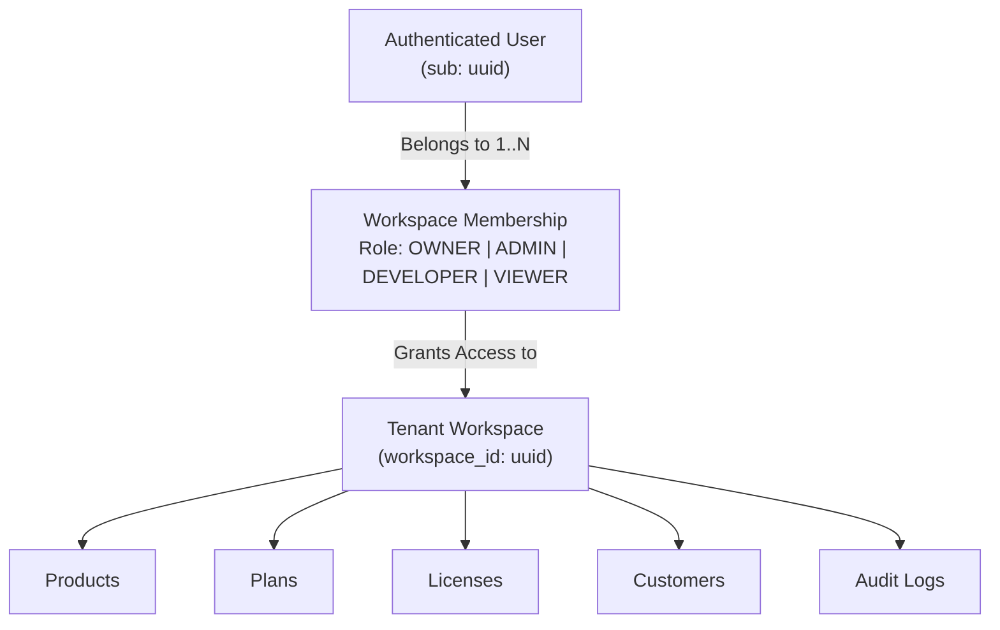

# Rightful – Workspace Multi-Tenancy & Authorization Model

## 1. Multi-Tenant Architectural Model

Rightful adopts a **Shared Database, Shared Schema with Logical Workspace Partitioning** model.

### 1.1 Tenant Definition
A **Workspace** represents an isolated tenant boundary (e.g., an individual developer's account, an agency, or a corporate software vendor). All core entities—including Products, Plans, Customers, Licenses, and Audit Records—are strictly owned by a single Workspace.



---

## 2. Role-Based Access Control (RBAC) Matrix

Within each workspace, members are assigned exactly one role:

| Action / Capability | OWNER | ADMIN | DEVELOPER | VIEWER |
| :--- | :---: | :---: | :---: | :---: |
| Delete Workspace | ✅ | ❌ | ❌ | ❌ |
| Manage Workspace Billing & Plan | ✅ | ✅ | ❌ | ❌ |
| Invite / Remove Members | ✅ | ✅ | ❌ | ❌ |
| Manage Signing Keys & Products | ✅ | ✅ | ✅ | ❌ |
| Create / Revoke / Renew Licenses | ✅ | ✅ | ✅ | ❌ |
| View Customers & Licenses | ✅ | ✅ | ✅ | ✅ |
| View Audit Logs | ✅ | ✅ | ✅ | ✅ |
| Validate Licenses via API | Public API / Token Authenticated |

---

## 3. Enforcement Strategy in Spring Boot

### 3.1 Method-Level Security
Spring Security annotations guard domain service and controller entrypoints:
```java
@PreAuthorize("@workspaceSecurity.hasPermission(#workspaceId, 'LICENSE_WRITE')")
@PostMapping("/workspaces/{workspaceId}/licenses")
public ApiResponse<LicenseResponse> createLicense(...) { ... }
```

### 3.2 Tenant Isolation in Data Access
1. Every repository query filtering tenant-owned entities enforces `where workspace.id = :workspaceId`.
2. Hibernate filters and JPA Specifications automatically append workspace predicates to avoid manual query omission errors.
3. Access attempts referencing a `workspaceId` where the caller has no membership result in an immediate `403 Forbidden` or `404 Not Found` (to prevent workspace enumeration).
