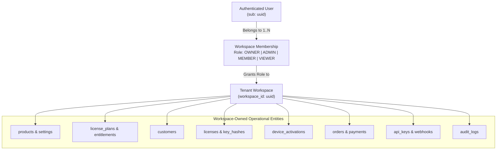

# Rightful – Multi-Tenant Workspace Authorization & RBAC Specification (Step 3.3)

## 1. Multi-Tenant Workspace Architecture

Rightful adopts a **Shared Database, Shared Schema with Logical Workspace Partitioning** model.

### 1.1 Tenant Definition
A **Workspace** is the fundamental security boundary in Rightful. All software products, license plans, customers, active licenses, device activations, commercial orders, developer API keys, webhooks, and audit logs are strictly owned by exactly one Workspace.



---

## 2. Workspace Roles Definition

Every user assigned to a workspace holds exactly one role within that workspace:

1. **`OWNER`**: Creator or designated primary custodian of the workspace. Holds irrevocable administrative control, billing ownership, key deletion rights, and the exclusive ability to delete the workspace or transfer ownership.
2. **`ADMIN`**: Trusted team administrator. Can manage members, invite collaborators, configure software products, issue and revoke licenses, manage webhooks, and configure payment gateways. Cannot delete the workspace or remove the OWNER.
3. **`MEMBER`**: Operational staff / developer. Can register products, create plans, generate and issue licenses, inspect customer records, and review activations. Cannot modify billing, rotate master keys, or manage team members.
4. **`VIEWER`**: Read-only auditor or customer support representative. Can inspect products, licenses, activation statuses, and telemetry. Cannot generate licenses, alter configurations, or view sensitive API keys.

---

## 3. Comprehensive Role & Permission Matrix

| Capability / Action | OWNER | ADMIN | MEMBER | VIEWER |
| :--- | :---: | :---: | :---: | :---: |
| **Workspace Management** | | | | |
| Delete Workspace | ✅ | ❌ | ❌ | ❌ |
| Update Workspace Name / Slug | ✅ | ✅ | ❌ | ❌ |
| Manage Workspace Subscription Tier | ✅ | ❌ | ❌ | ❌ |
| **Team & Collaboration** | | | | |
| Transfer Workspace Ownership | ✅ | ❌ | ❌ | ❌ |
| Invite / Remove Members | ✅ | ✅ | ❌ | ❌ |
| Modify Member Roles | ✅ | ✅ (Non-Owners) | ❌ | ❌ |
| View Member List | ✅ | ✅ | ✅ | ✅ |
| **Products & Cryptographic Keys** | | | | |
| Register Software Product | ✅ | ✅ | ✅ | ❌ |
| Rotate Product Ed25519 Signing Keys| ✅ | ✅ | ❌ | ❌ |
| Update Product Settings (Grace, Heartbeat)| ✅ | ✅ | ✅ | ❌ |
| Archive / Deprecate Product | ✅ | ✅ | ❌ | ❌ |
| **Plans & Entitlements** | | | | |
| Create / Edit License Plans | ✅ | ✅ | ✅ | ❌ |
| Configure Plan Entitlements & Features| ✅ | ✅ | ✅ | ❌ |
| Deactivate License Plan | ✅ | ✅ | ✅ | ❌ |
| **Customer Management** | | | | |
| Create / Edit Customer Records | ✅ | ✅ | ✅ | ❌ |
| Delete Customer Record | ✅ | ✅ | ❌ | ❌ |
| View Customer Directory | ✅ | ✅ | ✅ | ✅ |
| **License Operations** | | | | |
| Generate / Issue New License Key | ✅ | ✅ | ✅ | ❌ |
| Suspend License | ✅ | ✅ | ✅ | ❌ |
| Revoke License | ✅ | ✅ | ❌ | ❌ |
| Renew License Expiry | ✅ | ✅ | ✅ | ❌ |
| Override License Entitlements | ✅ | ✅ | ✅ | ❌ |
| View Licenses & Key Prefixes | ✅ | ✅ | ✅ | ✅ |
| **Device Activations & Seats** | | | | |
| Inspect Activated Devices | ✅ | ✅ | ✅ | ✅ |
| Deactivate Device / Free Seat | ✅ | ✅ | ✅ | ❌ |
| Inspect Activation Event Logs | ✅ | ✅ | ✅ | ✅ |
| **Orders & Billing** | | | | |
| Create / Fulfill Orders | ✅ | ✅ | ✅ | ❌ |
| Process Refunds | ✅ | ✅ | ❌ | ❌ |
| View Orders & Payments | ✅ | ✅ | ✅ | ✅ |
| **Developer Tools & Webhooks** | | | | |
| Generate Developer API Keys | ✅ | ✅ | ❌ | ❌ |
| Revoke API Keys | ✅ | ✅ | ❌ | ❌ |
| Create / Configure Webhooks | ✅ | ✅ | ❌ | ❌ |
| View Webhook Delivery Logs | ✅ | ✅ | ✅ | ✅ |
| **Compliance & Audit Logs** | | | | |
| View Audit Logs | ✅ | ✅ | ✅ | ✅ |

---

## 4. Cross-Tenant Protection & Security Controls

Rightful enforces workspace boundary checks at **three independent architectural layers**:

### 4.1 Layer 1: Spring Security Method-Level Authorization
Controller endpoints verify access before invoking business services:
```java
@PreAuthorize("@workspaceSecurity.hasRole(#workspaceId, 'ADMIN')")
@PostMapping("/workspaces/{workspaceId}/products/{productId}/rotate-keys")
public ApiResponse<ProductResponse> rotateKeys(...) { ... }
```
- `@workspaceSecurity` validates:
  1. Authenticated user ID (`sub`).
  2. Active membership in `#workspaceId`.
  3. Evaluates if user's role satisfies the required permission level.

### 4.2 Layer 2: Service-Layer Tenant Verification
- Domain services verify that any child entity referenced in a request belongs to `#workspaceId`:
  ```java
  License license = licenseRepository.findById(licenseId)
      .filter(l -> l.getWorkspace().getId().equals(workspaceId))
      .orElseThrow(() -> new ResourceNotFoundException("License", "id", licenseId));
  ```
- Cross-tenant references (e.g. attempting to link a license in Workspace A to a customer in Workspace B) trigger immediate `ResourceNotFoundException` (preventing information disclosure).

### 4.3 Layer 3: PostgreSQL Row Level Security (RLS)
- As specified in `authentication-security.md`, the connection pool sets `app.current_workspace_id`.
- Even in the event of an application logic bug or query omission, PostgreSQL refuses to return or update rows with differing `workspace_id`.

---

## 5. Unresolved Architectural Decisions

- **[PROPOSED] Organization / Team Sub-Workspaces**: Support for nested sub-workspaces for large software vendors with separate departmental units. (Deferred to Milestone 8).
- **[PROPOSED] Granular Custom Roles**: Allowing enterprise vendors to define customized role definitions (e.g. `SUPPORT_TIER_1` vs `SUPPORT_TIER_2`). (Deferred to Milestone 8).
