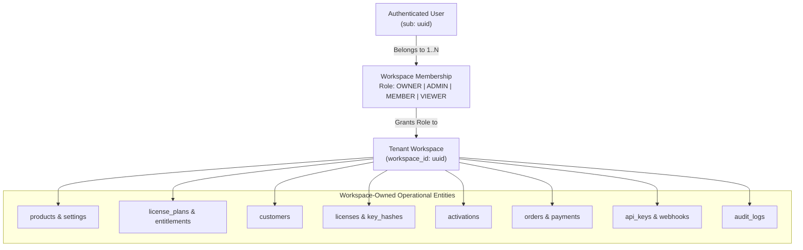

# Rightful – Multi-Tenant Workspace Authorization & RBAC Specification (Step 3.3)

## 1. Multi-Tenant Workspace Architecture

Rightful adopts a **Shared Database, Shared Schema with Logical Workspace Partitioning** model.

### 1.1 Tenant Definition
A **Workspace** is the fundamental security boundary in Rightful. All software products, license plans, customers, active licenses, device activations, commercial orders, developer API keys, webhooks, and audit logs are strictly owned by exactly one Workspace.



---

## 2. Workspace Roles Definition

Every user assigned to a workspace holds exactly one role within that workspace:

1. **`OWNER`**: Creator or designated primary custodian of the workspace. Holds irrevocable administrative control, billing ownership, key deletion rights, and the exclusive ability to delete the workspace or transfer ownership.
2. **`ADMIN`**: Trusted team administrator. Can manage members, invite collaborators, configure software products, issue and revoke licenses, manage webhooks, and configure payment gateways. Cannot delete the workspace or remove the OWNER.
3. **`MEMBER`**: Operational staff / developer. Can register products, create plans, generate and issue licenses, inspect customer records, and review activations. Cannot modify billing, rotate master keys, or manage team members.
4. **`VIEWER`**: Read-only auditor or customer support representative. Can inspect products, licenses, activation statuses, and telemetry. Cannot generate licenses, alter configurations, or view sensitive API keys.

---

## 3. Comprehensive Role & Permission Matrix

| Capability / Action | OWNER | ADMIN | MEMBER | VIEWER |
| :--- | :---: | :---: | :---: | :---: |
| **Workspace Management** | | | | |
| Delete Workspace | ✅ | ❌ | ❌ | ❌ |
| Update Workspace Name / Slug | ✅ | ✅ | ❌ | ❌ |
| Manage Workspace Subscription Tier | ✅ | ❌ | ❌ | ❌ |
| **Team & Collaboration** | | | | |
| Transfer Workspace Ownership | ✅ | ❌ | ❌ | ❌ |
| Invite / Remove Members | ✅ | ✅ | ❌ | ❌ |
| Modify Member Roles | ✅ | ✅ (Non-Owners) | ❌ | ❌ |
| View Member List | ✅ | ✅ | ✅ | ✅ |
| **Products & Cryptographic Keys** | | | | |
| Register Software Product | ✅ | ✅ | ✅ | ❌ |
| Rotate Product Ed25519 Signing Keys| ✅ | ✅ | ❌ | ❌ |
| Update Product Settings (Grace, Heartbeat)| ✅ | ✅ | ✅ | ❌ |
| Archive / Deprecate Product | ✅ | ✅ | ❌ | ❌ |
| **Plans & Entitlements** | | | | |
| Create / Edit License Plans | ✅ | ✅ | ✅ | ❌ |
| Configure Plan Entitlements & Features| ✅ | ✅ | ✅ | ❌ |
| Deactivate License Plan | ✅ | ✅ | ✅ | ❌ |
| **Customer Management** | | | | |
| Create / Edit Customer Records | ✅ | ✅ | ✅ | ❌ |
| Delete Customer Record | ✅ | ✅ | ❌ | ❌ |
| View Customer Directory | ✅ | ✅ | ✅ | ✅ |
| **License Operations** | | | | |
| Generate / Issue New License Key | ✅ | ✅ | ✅ | ❌ |
| Suspend License | ✅ | ✅ | ✅ | ❌ |
| Revoke License | ✅ | ✅ | ❌ | ❌ |
| Renew License Expiry | ✅ | ✅ | ✅ | ❌ |
| Override License Entitlements | ✅ | ✅ | ✅ | ❌ |
| View Licenses & Key Prefixes | ✅ | ✅ | ✅ | ✅ |
| **Device Activations & Seats** | | | | |
| Inspect Activated Devices | ✅ | ✅ | ✅ | ✅ |
| Deactivate Device / Free Seat | ✅ | ✅ | ✅ | ❌ |
| Inspect Activation Event Logs | ✅ | ✅ | ✅ | ✅ |
| **Orders & Billing** | | | | |
| Create / Fulfill Orders | ✅ | ✅ | ✅ | ❌ |
| Process Refunds | ✅ | ✅ | ❌ | ❌ |
| View Orders & Payments | ✅ | ✅ | ✅ | ✅ |
| **Developer Tools & Webhooks** | | | | |
| Generate Developer API Keys | ✅ | ✅ | ❌ | ❌ |
| Revoke API Keys | ✅ | ✅ | ❌ | ❌ |
| Create / Configure Webhooks | ✅ | ✅ | ❌ | ❌ |
| View Webhook Delivery Logs | ✅ | ✅ | ✅ | ✅ |
| **Compliance & Audit Logs** | | | | |
| View Audit Logs | ✅ | ✅ | ✅ | ✅ |

---

## 4. Cross-Tenant Protection & Security Controls

Rightful enforces workspace boundary checks at **three independent architectural layers**:

### 4.1 Layer 1: Spring Security Method-Level Authorization
Controller endpoints verify access before invoking business services:
```java
@PreAuthorize("@workspaceSecurity.hasRole(#workspaceId, 'ADMIN')")
@PostMapping("/workspaces/{workspaceId}/products/{productId}/rotate-keys")
public ApiResponse<ProductResponse> rotateKeys(...) { ... }
```
- `@workspaceSecurity` validates:
  1. Authenticated user ID (`sub`).
  2. Active membership in `#workspaceId`.
  3. Evaluates if user's role satisfies the required permission level.

### 4.2 Layer 2: Service-Layer Tenant Verification
- Domain services verify that any child entity referenced in a request belongs to `#workspaceId`:
  ```java
  License license = licenseRepository.findById(licenseId)
      .filter(l -> l.getWorkspace().getId().equals(workspaceId))
      .orElseThrow(() -> new ResourceNotFoundException("License", "id", licenseId));
  ```
- Cross-tenant references (e.g. attempting to link a license in Workspace A to a customer in Workspace B) trigger immediate `ResourceNotFoundException` (preventing information disclosure).

### 4.3 Layer 3: PostgreSQL Row Level Security (RLS)
- As specified in `authentication-security.md`, the connection pool sets `app.current_workspace_id`.
- Even in the event of an application logic bug or query omission, PostgreSQL refuses to return or update rows with differing `workspace_id`.

---

## 5. Unresolved Architectural Decisions

- **[PROPOSED] Organization / Team Sub-Workspaces**: Support for nested sub-workspaces for large software vendors with separate departmental units. (Deferred to Milestone 8).
- **[PROPOSED] Granular Custom Roles**: Allowing enterprise vendors to define customized role definitions (e.g. `SUPPORT_TIER_1` vs `SUPPORT_TIER_2`). (Deferred to Milestone 8).

---

## 6. Step 3.7 Implementation Reference: WorkspaceSecurityEvaluator

### 6.1 Evaluator Architecture
Implemented in [`WorkspaceSecurityEvaluator.java`](file:///d:/RIGHTFUL.com/backend/src/main/java/com/rightfull/workspace/security/WorkspaceSecurityEvaluator.java) as `@Component("workspaceSecurity")`:
- Resolves authenticated user from SecurityContext JWT `sub` claim.
- Looks up user membership in `workspace_members`.
- Enforces role hierarchy: `OWNER` (level 4) > `ADMIN` (level 3) > `MEMBER` (level 2) > `VIEWER` (level 1).
- Rejects requests from non-members with HTTP 403 Forbidden.
- Rejects role escalation attempts (e.g. MEMBER attempting ADMIN actions) with HTTP 403 Forbidden.

### 6.2 Protected Workspace Endpoints
Implemented in [`WorkspaceController.java`](file:///d:/RIGHTFUL.com/backend/src/main/java/com/rightfull/workspace/controller/WorkspaceController.java):
- `GET /api/v1/workspaces/{workspaceId}`: Requires `VIEWER` role.
- `PUT /api/v1/workspaces/{workspaceId}`: Requires `ADMIN` role.
- `DELETE /api/v1/workspaces/{workspaceId}`: Requires `OWNER` role.
- `GET /api/v1/users/me`: Authenticated profile endpoint returning user identity, default workspace, and all active workspace memberships with their assigned roles.

---

## 7. Step 3.8 Implementation Reference: Workspace Management & Authorization Foundation

### 7.1 Workspace Lifecycle
Workspaces transition through states (`ACTIVE`, `SUSPENDED`, `ARCHIVED`):
1. **Creation**: `POST /api/v1/workspaces`. Authenticated user is automatically provisioned as `OWNER`. Unique slug is validated or generated. Automatically assigned as default workspace in `user_preferences` if none exists.
2. **Retrieval**: `GET /api/v1/workspaces` (list memberships for user) and `GET /api/v1/workspaces/{workspaceId}` (details for members with at least `VIEWER`).
3. **Settings Update**: `PATCH` / `PUT /api/v1/workspaces/{workspaceId}`. Restricted to `ADMIN` or `OWNER`.
4. **Archiving**: `POST /api/v1/workspaces/{workspaceId}/archive`. Restricted strictly to `OWNER`.
5. **Ownership Transfer**: `POST /api/v1/workspaces/{workspaceId}/transfer-ownership`. Restricted strictly to current `OWNER`. The target must be an existing active member. Current owner is demoted to `ADMIN`, and target is promoted to `OWNER`.
6. **Deletion**: `DELETE /api/v1/workspaces/{workspaceId}`. Restricted strictly to `OWNER`.

### 7.2 Membership Lifecycle & Role Hierarchy
- **Listing & Details**: `GET /api/v1/workspaces/{workspaceId}/members` and `GET /api/v1/workspaces/{workspaceId}/members/{memberId}` accessible to any active member (`VIEWER+`).
- **Role Modification**: `PATCH /api/v1/workspaces/{workspaceId}/members/{memberId}` restricted to `ADMIN` or `OWNER`.
  - Anti-escalation rule: `ADMIN` cannot modify peer `ADMIN` or `OWNER`.
  - Anti-escalation rule: `ADMIN` cannot promote another member to `ADMIN` (only `OWNER` can promote to `ADMIN`).
  - Target role cannot be set to `OWNER` via this endpoint (must use `transfer-ownership`).
  - Cannot change the role of the workspace `OWNER`.
- **Member Removal / Leave**: `DELETE /api/v1/workspaces/{workspaceId}/members/{memberId}`.
  - Last OWNER protection: Cannot delete or leave if user is the last `OWNER` of the workspace.
  - `ADMIN` cannot remove peer `ADMIN` or `OWNER`.
  - `OWNER` can remove any member (except last owner condition).
  - Voluntarily leaving is permitted for non-owners or when multiple owners exist.
  - Clears `default_workspace_id` in `user_preferences` if the removed workspace was the user's default.

### 7.3 Invitation Lifecycle & Cryptographic Token Security
1. **Creation**: `POST /api/v1/workspaces/{workspaceId}/invitations` (ADMIN+).
   - Generates 32-byte cryptographically secure random token (64 hex characters).
   - Computes SHA-256 hash and stores `token_hash` in `workspace_invitations`. Raw token is never stored in DB.
   - Raw token is returned exactly once in the creation response and emailed via `EmailService`.
   - Expiration set to 7 days.
   - Prevents duplicate active pending invitations for the same email.
   - Prohibits issuing invitations with `OWNER` role.
2. **List & Revocation**: `GET /api/v1/workspaces/{workspaceId}/invitations` and `DELETE /api/v1/workspaces/{workspaceId}/invitations/{invitationId}` (ADMIN+).
3. **Acceptance**: `POST /api/v1/invitations/{token}/accept`.
   - Hashes incoming raw token with SHA-256 and retrieves invitation.
   - Validates status is `PENDING` and invitation has not expired.
   - Enforces email binding: Authenticated user's email must match `invitation.email` (HTTP 403 `EMAIL_MISMATCH` on failure).
   - Creates `WorkspaceMember` record with specified role and marks invitation `ACCEPTED`.
4. **Rejection**: `POST /api/v1/invitations/{token}/reject`.
   - Marks invitation `REJECTED`. Single-use enforcement prevents subsequent redemptions.

### 7.4 Default Workspace Management
- `GET /api/v1/users/me/default-workspace`: Retrieves user's active default workspace. If membership is no longer active (e.g. removed), clears the stale reference.
- `POST /api/v1/users/me/default-workspace`: Sets default workspace. Validates that the authenticated user holds an active membership in the selected workspace (preventing cross-tenant unauthorized selection).

### 7.5 Audit Logging Abstraction
Security-sensitive workspace operations dispatch structured audit records via `WorkspaceAuditService`:
- `WORKSPACE_CREATED`
- `WORKSPACE_UPDATED`
- `WORKSPACE_ARCHIVED`
- `WORKSPACE_OWNERSHIP_TRANSFERRED`
- `MEMBER_INVITED`
- `INVITATION_ACCEPTED`
- `INVITATION_REJECTED`
- `INVITATION_REVOKED`
- `MEMBER_ROLE_CHANGED`
- `MEMBER_REMOVED`
- `DEFAULT_WORKSPACE_CHANGED`

### 7.6 Multi-Tenant Security Hardening (Step 3.9 Implementation)
> [!IMPORTANT]
> Step 3.9 establishes defense-in-depth database isolation via PostgreSQL Row-Level Security (RLS) and least-privilege role separation:
> 1. **Application Runtime Role (`rightfull_app`)**:
>    - Dedicated non-superuser database role without `BYPASSRLS`.
>    - Owns zero tables; granted only DML (`SELECT, INSERT, UPDATE, DELETE`) on `public` tables.
> 2. **Transaction-Scoped Tenant Context**:
>    - Set via parameterized `set_config('app.current_workspace_id', :wsId, true)` with `is_local = true`.
>    - Automatically destroyed at transaction boundaries (commit or rollback), preventing connection pool leakage.
> 3. **AOP Aspect & Thread-Local Protection**:
>    - `TenantContextAspect` automatically binds `TenantContext` to the active PostgreSQL transaction.
>    - `TenantContextCleanupFilter` unconditionally clears thread-local state on request completion.
> 4. **Database-Level RLS Enforcement**:
>    - Every tenant-scoped entity evaluates against `app_current_workspace_id()`.
>    - Cross-workspace reads, writes, updates, and deletes are physically blocked by the PostgreSQL engine.
> 5. **Immutable Persistent Auditing**:
>    - `audit_logs` records all 11 lifecycle events.
>    - Engine-level trigger `trg_audit_logs_prevent_mutation` prevents `UPDATE` and `DELETE` even by database administrators.


